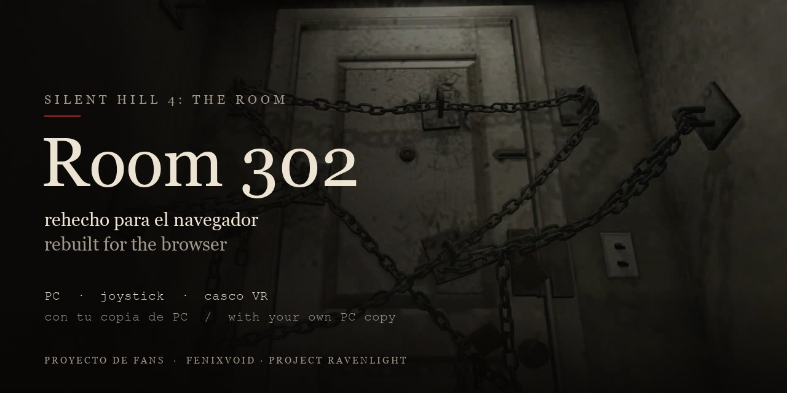
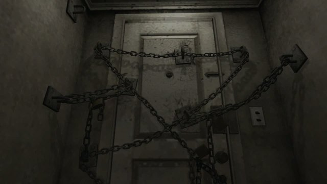
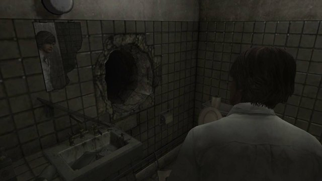
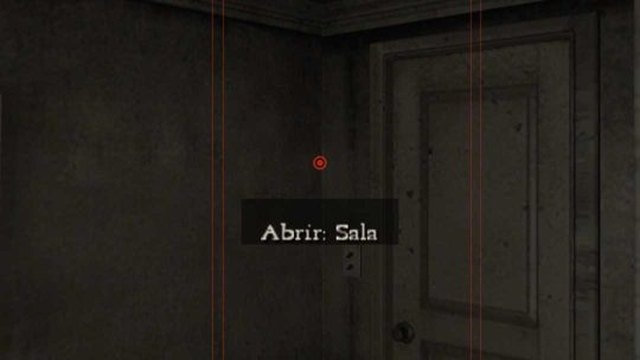
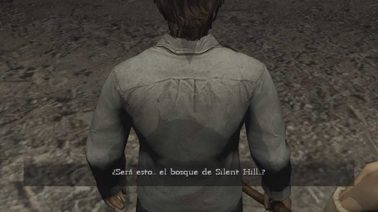
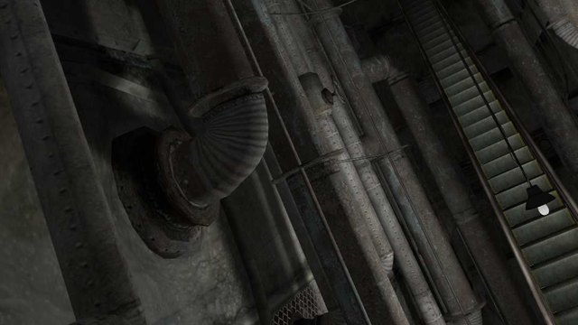
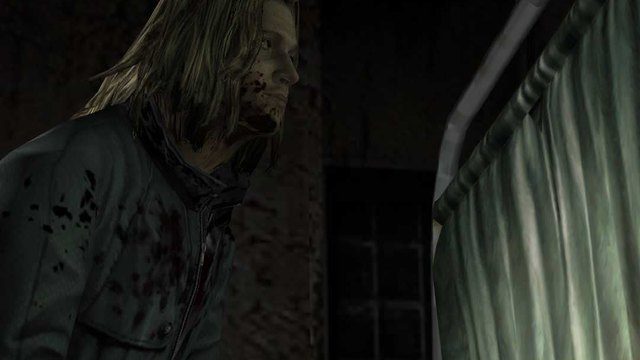
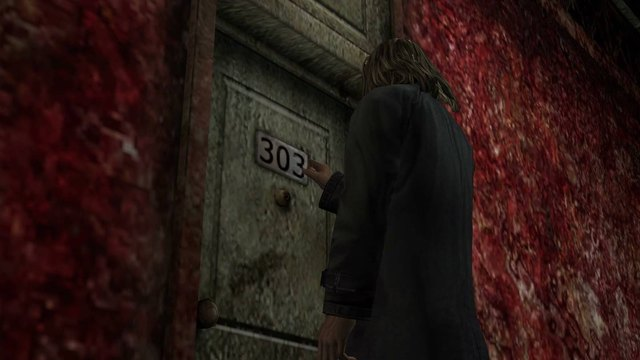
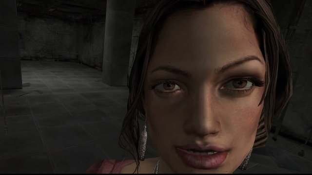
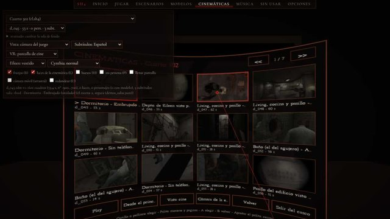

<p align="center"></p>

<p align="center">
<b>Silent Hill 4: The Room, rebuilt for the browser.</b> Play it on PC, with a gamepad or in a VR headset, using <b>your own PC copy of the game (GOG)</b>.
</p>

<p align="center">
<a href="https://sh4.ravenlight.net"><b>▶ Play online</b></a> ·
<a href="https://github.com/vjravenlight/room302/releases/latest"><b>⬇ Download</b></a> ·
<a href="https://github.com/vjravenlight/room302/issues/new/choose"><b>✉ Report a problem</b></a>
</p>

<p align="center">
<a href="https://github.com/vjravenlight/room302/releases/latest"></a>
<a href="https://github.com/vjravenlight/room302/releases"></a>
</p>

<p align="center"><a href="README.md">Versión en castellano</a></p>

> **Fan project, non-profit.** It ships no game files: it reads them from your own PC copy of *Silent Hill 4: The Room*.
> Silent Hill is a trademark of Konami. This project is not affiliated with Konami.

---

## Contents

[What it is](#what-it-is) · [Screenshots](#screenshots) · [How to play](#how-to-play) · [Requirements](#requirements) · [Controls](#controls) ·
[Cameras and options](#cameras-and-options) · [The Suite](#the-suite) · [From source](#running-from-source) ·
[Troubleshooting](#troubleshooting) · [Contributing](#contributing) · [Credits](#credits-and-legal)

## What it is

Room 302 rebuilds *Silent Hill 4: The Room* (Team Silent, 2004) inside the browser, with Three.js and WebXR.
We studied how the original works and put it back together piece by piece: rooms, lighting, characters, cutscenes,
sound and game logic. Everything is read **live from your copy**: rooms, textures, models, animations, cutscenes, music
and texts. Nothing was converted or copied.

**What was kept from the original**

- Room 302 in first person, with each day's changes and the apartment's hauntings.
- The worlds in third person, with their fog, their lighting and the game's **fixed and rail cameras**.
- Henry's movement and combat with the game's own numbers, and the **AI of the enemies and of Eileen**.
- Cutscenes with their camera, lights and audio; Akira Yamaoka's music and ambiences.
- The game's texts, subtitles and font, in its **8 languages**.
- Saving in the red notebook in room 302, as in the original.

**What was added**

- **VR headset** (Meta Quest / Pico): first person with Henry's body and hands and the weapon in your hand, or third
  person on a cinema screen with the game cameras. Hand tracking works too, no controllers needed.
- **More cameras:** over the shoulder, free, and first person in the worlds. Cutscenes can be watched through Henry's eyes.
- **Photo mode** at any time, cutscenes included: 4K and 8K photos, and 360° photos.
- **Cutscene video export** in 4K, 1080p, 360° or vertical 9:16.
- Gamepad, touch screen, aiming help, aim guides, adjustable fog and brightness, and an Enhanced mode.
- **The Suite**, to browse 182 cutscenes, 301 rooms, 413 models and the music at your own pace.

## Screenshots

<table>
<tr>
<td width="33%"><br><sub>The chained door of room 302</sub></td>
<td width="33%"><br><sub>The hole in the bathroom</sub></td>
<td width="33%"><br><sub>First person with aim guides (optional)</sub></td>
</tr>
<tr>
<td><br><sub>The forest, with the game's subtitles</sub></td>
<td><br><sub>The subway, with the game camera</sub></td>
<td><br><sub>Walter, with the scene lighting</sub></td>
</tr>
<tr>
<td><br><sub>Cutscenes, inside the engine</sub></td>
<td><br><sub>Eileen</sub></td>
<td><br><sub>The Suite: Cutscenes, also in the headset</sub></td>
</tr>
</table>

## How to play

### 1. Online (fastest)

1. Go to **[sh4.ravenlight.net](https://sh4.ravenlight.net)** with **Chrome or Edge on a PC** and click **Play online**.
2. Choose the folder where the game is installed (the one with `data`, `demo` and `movie`).
   The folder is **not uploaded anywhere**: the browser reads it from your PC.
3. Next time it remembers it: Chrome just asks for permission with one click.

> Firefox, Safari, phones and the headset browser cannot open a folder on your PC. Use the downloaded version for those.

### 2. Downloaded (Windows)

1. Download the latest **[Release](https://github.com/vjravenlight/room302/releases/latest)** (`SH4web_vX.zip`) and unzip it anywhere.
2. Double-click **`INSTALAR.cmd`** and choose the game folder. If it is in `C:\GOG Games\Silent Hill 4`, it finds it by itself.
3. Your browser opens at `http://127.0.0.1:8130/suite.html` and you're in.

Next time, use the **"SH4 web"** desktop shortcut (or `JUGAR.cmd`). The black window is the server: keep it open while
playing. Nothing else to install: Node is included.

**The first run needs internet:** it downloads some data tables (about 6 MB) from `sh4.ravenlight.net` and keeps them. After that it works offline.

**Phone or tablet:** on the PC run `JUGAR_EN_RED.cmd` instead of `JUGAR.cmd`. It shows the address
(`http://<your PC's IP>:8130/suite.html`) to open from a phone on the same Wi-Fi. Use it **only on your home network**:
`JUGAR.cmd` only serves the PC itself, for safety (if Windows asks about the firewall, allow it on "Private networks"
only).

### 3. With a VR headset (Meta Quest / Pico)

- **From the PC:** with Quest Link, Air Link or Virtual Desktop, open the Suite in Chrome or Edge on the PC and click **Enter VR**.
  Works both online and downloaded.
- **With the headset browser, over USB:** with the downloaded version running, connect the headset by USB (developer mode)
  and run **`CASCO_USB.cmd`**. Then open `http://127.0.0.1:8130/suite.html` in the headset browser.
  It needs `adb` (Android Platform Tools); if you don't have it, the script tells you where to get it and where to put it.

## Requirements

| | Online | Downloaded |
|---|---|---|
| System | any with desktop **Chrome or Edge** | **Windows** |
| The game | your installed PC copy of *Silent Hill 4: The Room* ([GOG](https://www.gog.com/en/game/silent_hill_4_the_room)) | same |
| Disk space | the game's (about 3.5 GB) | the game + about 120 MB for the Release |
| Internet | yes | first run only |

For VR: Meta Quest or Pico. The **Quest enhanced** option needs a Quest 3.

## Controls

The controls are also shown on screen (the help at the bottom left and in each menu).

### Keyboard and mouse

| Action | Key |
|---|---|
| Move / choose in menus | **WASD** or **arrows** |
| Run | **Shift** (hold) |
| Look | **mouse** (click to capture it, **Esc** releases it) |
| Examine / open doors | **E** or **F** (in room 302 also left click) |
| Accept | **Enter** (or Space in menus) |
| Back / skip a scene | **Esc** or **Backspace** |
| Pause | **Tab** or **M** |
| Inventory | **I** |
| Ready the weapon | **right click** or **K** (hold) |
| Attack (hold = charged attack) | **left click**, **Space** or **J** |
| Step back | **X** with the weapon ready, or **Shift+S** |
| Side step (on guard) | **Shift+A** / **Shift+D** |
| Center the camera behind Henry | **X** |
| First / third person in the worlds | **V** |
| Photo mode | **C** or **F2** |

### Gamepad (Xbox or compatible)

| Action | Button |
|---|---|
| Walk | left stick |
| Look / turn the camera | right stick |
| Accept | **A** |
| Back | **B** |
| Examine / doors | **X** |
| Pause | **Start** (Menu) |
| Navigate menus | d-pad |
| Photo mode | **Select** (Back / View) |

> In this version the gamepad has no buttons for fighting or running yet: use keyboard and mouse, touch or the headset for that.

### Touch screen (phone or tablet)

| Action | How |
|---|---|
| Walk | the on-screen joystick (left side; can be moved to the right in Options) |
| Look | drag a finger |
| Examine / advance text | tap the screen or **EXAMINE** |
| Run | **RUN** (toggle) |
| Accept / back | **OK** / **BACK** |
| Pause | **MENU** |
| Photo mode | **PHOTO** |
| In the worlds | **AIM** (hold), **ATTACK** (hold = charged), **STEP** (step back), **ITEMS** (inventory), **VIEW** (1st / 3rd person) |

### VR headset (with controllers)

| Action | How |
|---|---|
| Walk | left-hand stick (press it = run) |
| Turn | right-hand stick (30° snaps or smooth) |
| Choose in menus | ray with a **red dot**; trigger, **A** or pinch accept; **B** goes back |
| Examine / doors | **A** (in room 302 also the trigger) |
| Ready the weapon / attack | **grip** / **trigger** of the weapon hand, or swing your arm |
| Finish a downed enemy | the other hand's trigger |
| Step back | **X** |
| Inventory | **Y** (a panel on your left hand) |
| Switch weapon | short click of the left stick |
| Third person (cinema screen) | **B** (**B** again goes back) |
| Pause | press the right stick |
| Photo mode | press **both sticks** at once |

With **Options → Dominant hand: left** everything is mirrored.
**Hand tracking, no controllers:** pinch with your left hand and move it to walk (like a stick); the other hand's pinch
accepts and examines; looking at your left palm for half a second opens the inventory; in room 302, palm facing your face
plus a held pinch opens the pause menu.

### Photo mode

Entering it freezes everything, including a cutscene on its current frame. Photos are saved to **Downloads**.

| Action | PC | Gamepad | Headset |
|---|---|---|---|
| Enter / exit | **C** or **F2** (Esc also exits) | **Select** | both sticks |
| Look / move | mouse · **WASD** / arrows | — | one stick flies, the other turns, goes up and down |
| Up / down | **E** or Space / **Q** | **RB** / **LB** | — |
| Fast | **Shift** | — | grip |
| Zoom | wheel or **+ −** | **LT** / **RT** | — |
| Roll / level | **Z** / **X** · **R** | — | — |
| Photo | **P** = 4K (Shift: 8K) · **Enter** = the chosen size | — | trigger |
| 360° photo | **O** = 8K (Shift: 4K) | — | the other hand's trigger |
| Options (characters, Henry, effects, noise, fog, subtitles, enhanced) | **1** to **7** | — | A/X: characters |
| Hide the panel | **H** | — | — |

On a phone: one finger looks, two fingers move, pinch = zoom, plus the UP / DOWN buttons.

## Cameras and options

**Cameras.** Room 302 is always first person, as in the original. In the worlds, pick one in **Options → Camera settings**:

- **Game:** the original fixed and rail cameras.
- **Over the shoulder:** follows Henry as he walks; turn it with the mouse, the right stick or a finger.
- **Free:** turns only with the mouse, the right stick or a finger, around Henry.
- **First person:** through Henry's eyes (**V** or **VIEW**). You can fight this way too.

Shoulder and free cameras have smoothing, turning speed and distance settings.
**Cutscenes:** *Cutscene* (the game camera) or *Henry's eyes*. In the headset, also: cinema screen or inside the scene.

**Main options**

| Group | Options |
|---|---|
| Game | Language (the game's 8; the site interface is in Spanish or English), brightness, subtitles, music and effects volume, blood color (red, green or purple) |
| Image | Noise (0 to 10), fog (5 = as in the game), character brightness and shadows, image quality (low, medium, high) |
| Help | Aiming help (full, dot only or off), aim guides (outline the door or item in red) |
| Mouse | Sensitivity, invert |
| Touch | Button size, joystick side, vibration |
| Headset | Turning (snap or smooth), vignette when moving, posture (standing or seated), scale, dominant hand, Henry's body, Quest enhanced |

Options and saved games are stored in your browser.

## The Suite

The Suite (`suite.html`) is the entry point to everything, on the PC or in the headset:

- **Play:** from the opening nightmare or straight to room 302.
- **Cutscenes:** the game's 182 scenes inside the engine, frame by frame, with the game camera or free, through Henry's
  eyes, with bones and lights visible. They export **4K, 1080p, 360° or vertical 9:16 video** (for Instagram, TikTok or
  Shorts) with their sound, and have photo mode.
- **Rooms:** the 301 rooms to walk through in first or third person, with playable Henry, flashlight, the game's effects,
  Enhanced mode and 4K/8K/360° photos.
- **Models:** 413 models, characters and monsters, with their animations.
- **Music:** Akira Yamaoka's tracks, ambiences and voices, to listen to or save as WAV.
- **Archive:** the unused content left inside the game.

## Running from source

You need **Node.js 18 or newer** and your copy of the game. No dependencies to install, nothing to build.

```
git clone https://github.com/vjravenlight/room302.git
cd room302
node tools/servidor.mjs 8130 "C:\GOG Games\Silent Hill 4"
```

Then open **http://127.0.0.1:8130/suite.html**. The server is read-only: it serves `visor/`, the game folder at `/juego/`
and the tables at `/datos/` (downloaded from `sh4.ravenlight.net` the first time they are requested).

**Building the Release** (Windows, with Python 3):

```
python tools/armar_release.py --version X
```

Output goes to `_release/SH4web/` and `_release/SH4web_vX.zip`. It copies the installed `node.exe`
(`--node "path\node.exe"` if it is not in `C:\Program Files\nodejs`).

**Layout**

| Folder | Contents |
|---|---|
| `visor/` | everything that runs in the browser. Pages: `suite.html` (home), `modo_juego/juego.html` (Play), `index.html` (Rooms), `cine.html`, `modelos.html`, `musica.html`, `carpeta.html` (online) |
| `visor/modo_juego/` | the game: room 302, the worlds, menus, saving, photo mode |
| `visor/jugador/`, `visor/enemigos/` | Henry (movement, combat, inventory, headset) and the enemies |
| `visor/lib/` | game file readers, rooms, models, lighting, Three.js r170 |
| `tools/` | `servidor.mjs` (local server) and `armar_release.py` |
| `datos/` | empty in the repo: the tables download by themselves on first use |

The code is written in Spanish (names and texts); the in-game interface has full English.

## Troubleshooting

<details>
<summary><b>"The data folder is missing" or "can't find the game files"</b></summary>

You picked another folder. It must be the folder where the game is **installed**: it has to contain `data`, `demo` and
`movie` (with GOG it is usually `C:\GOG Games\Silent Hill 4`). In the downloaded version, to change it, delete
`config\carpeta_juego.txt` and run `INSTALAR.cmd` again.
</details>

<details>
<summary><b>"This browser cannot open a folder"</b></summary>

That happens with Firefox, Safari, phones and the headset browser. To play online use **Chrome or Edge on a PC**, or get
the downloaded version.
</details>

<details>
<summary><b>The headset won't enter VR</b></summary>

- With Link / Air Link / Virtual Desktop, open the page in **Chrome or Edge on the PC** (not in the headset browser) and click **Enter VR**.
- With `CASCO_USB.cmd`: the headset must be in **developer mode**, connected by USB, with **USB debugging accepted** in the
  headset. `JUGAR.cmd` must be running on the PC. If `adb` is missing, the script tells you where to get it.
</details>

<details>
<summary><b>Port 8130 is in use</b></summary>

Almost always another server window is already open: close it, or use that one. From source you can use another port:
`node tools/servidor.mjs 8131 "C:\GOG Games\Silent Hill 4"` and open `http://127.0.0.1:8131/suite.html`.
</details>

<details>
<summary><b>The browser doesn't open, or the screen is black</b></summary>

Open `http://127.0.0.1:8130/suite.html` by hand. If it stays black or runs slowly, try an up-to-date Chrome or Edge and
**Options → Image quality: low**.
</details>

<details>
<summary><b>My saved games are missing</b></summary>

Saves live in the browser, per address: online and downloaded are saved separately (and so are `127.0.0.1` and
`localhost`). As in the original, you save in the red notebook in room 302.
</details>

## Contributing

All help counts: bug reports, ideas, testing on other headsets or gamepads, interface translations and code.

- **Report a problem or suggest an idea:** [open an issue](https://github.com/vjravenlight/room302/issues/new/choose) with the templates.
- **Code:** read **[CONTRIBUTING.md](CONTRIBUTING.md)** before sending a pull request.

The code in this repository is published **without the internal working comments**: it is formatted and readable, but the
long explanations stay on the project side. If something is unclear, ask in an issue.

## Credits and legal

- ***Silent Hill 4: The Room*** © Konami. Created by **Team Silent**; directed by **Suguru Murakoshi**, music and sound by **Akira Yamaoka**.
- **Room 302** is a project by **FeniXVOID · Project Ravenlight** — **VJ Ravenlight** ([ravenlight.net](https://www.ravenlight.net)).
- Built with [Three.js](https://threejs.org) (MIT license, included in `visor/lib/three/`).

Silent Hill is a trademark of Konami. This is a non-profit fan project, not affiliated with Konami.
**No game files are included:** you need your own legally purchased PC copy.

License: to be decided.
