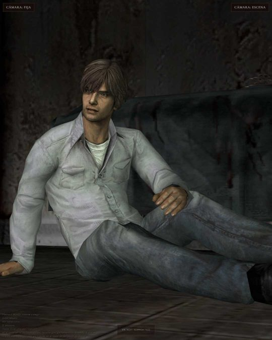
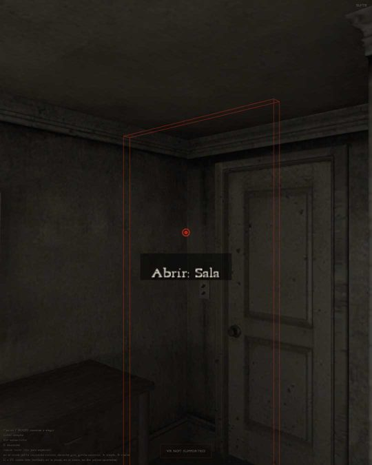
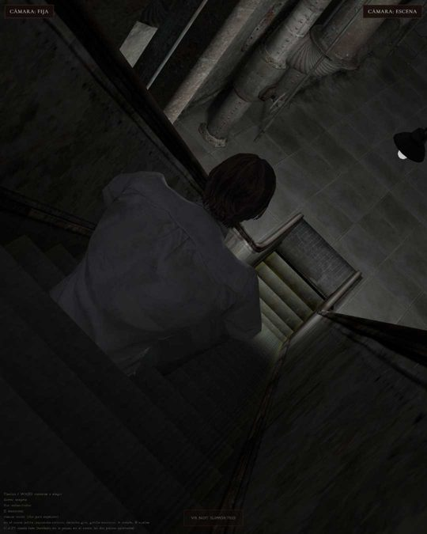
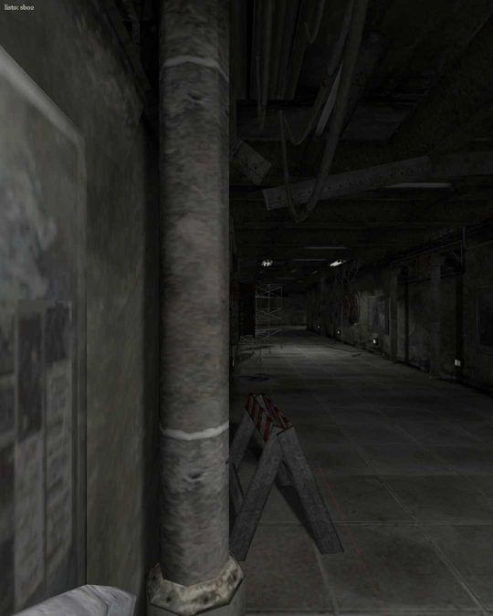
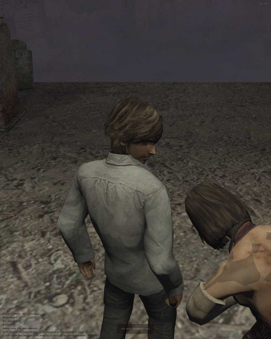
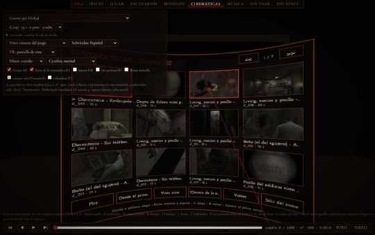

# Room 302 — SH4 web

**Silent Hill 4: The Room, rehecho para el navegador.** PC, celular y realidad virtual (Meta Quest / Pico).
*Silent Hill 4: The Room, rebuilt for the browser. PC, phone and VR. English below.*

> Tributo hecho por fans, sin fines de lucro. **No trae ningún archivo del juego:** necesitás tu propia copia de
> Silent Hill 4 para PC (GOG). Silent Hill es una marca de Konami.

  

## Jugar en 3 pasos

1. Bajá el último **[Release](../../releases/latest)** (`SH4web_vX.zip`) y descomprimilo donde quieras.
2. Doble clic en **`INSTALAR.cmd`** y elegí la carpeta del juego, la que tiene `data`, `demo` y `movie`.
   Si está en `C:\GOG Games\Silent Hill 4` la encuentra sola.
3. Se abre el navegador en `http://127.0.0.1:8130` y listo.

Las próximas veces usá el acceso directo **"SH4 web"** del Escritorio. La ventana negra es el servidor: dejala abierta mientras jugás.
No hay que instalar nada más, porque Node ya viene adentro. La primera vez necesita internet para bajar unas tablas de datos de sh4.ravenlight.net.

## Realidad virtual

- **Desde la PC:** abrí `http://127.0.0.1:8130/suite.html` en Chrome o Edge con Quest Link, Air Link o Virtual Desktop.
- **Con el navegador del casco:** conectá el casco por USB (en modo desarrollador) y corré **`CASCO_USB.cmd`**.
  Después abrí `http://127.0.0.1:8130/suite.html` en el casco. Hace falta `adb`; el archivo te dice de dónde sacarlo.

  

## Qué tiene

- **El 302 en primera persona,** con los cambios de cada día.
- **Todos los mundos en tercera persona,** con su niebla y su luz.
- **Varios modos de cámara:** las cámaras fijas del original, detrás del hombro, libre o primera persona.
  Las cinemáticas se ven con la cámara del juego o por los ojos de Henry.
- **La IA de los enemigos y de Eileen** se comporta como en el juego original.
- **Una Suite para recorrer** 182 cinemáticas, 301 salas y 371 modelos.
- **Controles:** teclado y mouse, joystick, pantalla táctil o casco VR, con las manos agarrando cada arma.

## Problemas comunes

- **"No está la carpeta data":** elegiste una carpeta equivocada. Tiene que ser la carpeta donde está instalado el juego.
- **No abre el navegador:** entrá a mano a `http://127.0.0.1:8130/suite.html`.
- **Para cambiar la carpeta del juego:** borrá `config\carpeta_juego.txt` y volvé a correr `INSTALAR.cmd`.

---

## English

**Play in 3 steps**
1. Download the latest **[Release](../../releases/latest)** and unzip it.
2. Double-click **`INSTALAR.cmd`** and choose your Silent Hill 4 PC (GOG) folder, the one with `data`, `demo` and `movie`.
3. Your browser opens at `http://127.0.0.1:8130`. Next time, use the **"SH4 web"** desktop shortcut.
   The first run needs internet to fetch some data tables from sh4.ravenlight.net.

**VR:** use Chrome or Edge on the PC with Quest Link, Air Link or Virtual Desktop. Or connect the headset by USB
in developer mode and run **`CASCO_USB.cmd`** to use the headset browser.

No game files are included. You need your own copy. Fan tribute, non-profit. Silent Hill is a trademark of Konami.

**FeniXVOID · Project Ravenlight**
